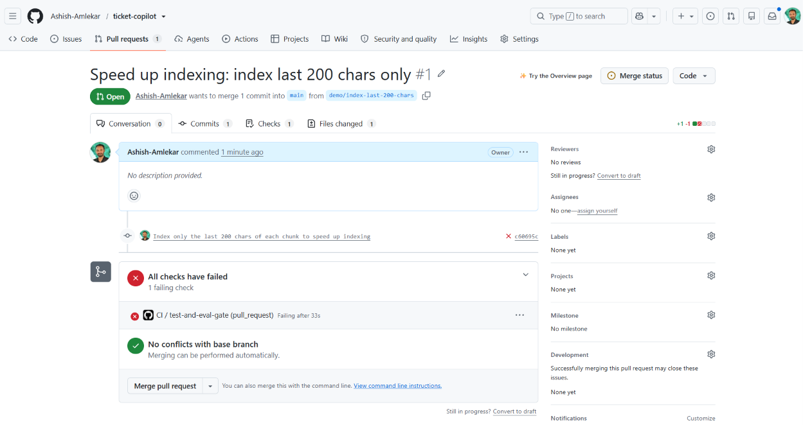

# Support Ticket Copilot

[](https://github.com/Ashish-Amlekar/ticket-copilot/actions/workflows/ci.yml)

An LLM service that triages a support ticket and drafts a **grounded, cited** reply.
The point of the project is the operations around the model, not the prompt: versioned
prompts, a model-agnostic client, structured output, an eval gate in CI, and tracing
with user feedback.

```
ticket ──► FastAPI ──► retrieve (BM25 / hybrid) ──► prompt (versioned) ──► LLM (LiteLLM)
                                                                              │
              traces.jsonl ◄── grounding check ◄── schema validation + retry ◄┘
              feedback.jsonl
```

The model must answer in JSON: `category`, `severity`, `likely_root_cause`,
`suggested_steps`, `draft_reply`, `citations`, `docs_gap`, `confidence`.

## Quick start

```bash
pip install -r requirements-dev.txt
python -m pytest -q              # fake LLM, no network needed
python -m evals.run_eval         # retrieval eval + pass/fail gate

ollama pull mistral              # or set LLM_MODEL to a hosted model
uvicorn app.main:app --port 8000 # interactive docs: http://localhost:8000/docs
```

## What is in here

| Piece | File | Why |
|---|---|---|
| Config from environment variables | `app/config.py` | Same code runs against any model, prompt version or knowledge base |
| Model-agnostic client | `app/llm.py` | LiteLLM: switch Ollama for a hosted model with `LLM_MODEL` |
| Versioned prompts | `prompts/triage/v1.yaml` | Prompt changes are diffed, reviewed and eval-gated |
| Structured output with retry | `app/schemas.py`, `app/pipeline.py` | Invalid JSON is re-asked, then fails loudly |
| Grounding check | `app/pipeline.py` | The model may only cite chunks that were retrieved |
| Eval gate | `evals/run_eval.py`, `evals/thresholds.yaml` | Exit code 1 when quality drops below the thresholds |
| Traces and feedback | `app/tracing.py` | Latency, tokens, cost, prompt version per request; accept/edit/reject per draft |
| CI | `.github/workflows/ci.yml` | Tests, eval gate and Docker build on every push and pull request |

## The eval gate in action

[Pull request #1](https://github.com/Ashish-Amlekar/ticket-copilot/pull/1) is a simulated
regression: indexing only the last 200 characters of each chunk "to speed up indexing".
All unit tests still pass, but retrieval hit rate falls from 1.00 to 0.90, and the eval
gate fails the build.



## What running it with a local 7B model showed

These are real observations from running Mistral 7B through Ollama on a CPU:

- **Latency:** 100 to 150 seconds per ticket. A full 12-ticket end-to-end eval would
  take roughly 25 minutes, so the default CI gate evaluates retrieval only.
- **Hallucinated reply on an out-of-scope ticket:** for a question the documentation
  cannot answer, the model correctly set `docs_gap: true` but its draft reply still stated
  a fact that appears nowhere in the knowledge base.
- **Citation formatting:** the model sometimes wrote `chunk_id: foo-1` instead of `foo-1`.
  The grounding check dropped those citations, which led to a normalisation fix and a test.
- **Overconfidence:** `confidence` came back as 1.0, so that field is not trustworthy yet.

## Known limitations

- The bundled knowledge base is a small **fictional** product ("Quillbus", 18 chunks) so
  the project runs offline. The golden set of 12 tickets was written from the same docs,
  so retrieval scores are near-perfect and say little about real-world quality.
- The end-to-end eval (`--llm`) is implemented but has not been run against a real model yet.
- Tracing is JSONL on disk, not Langfuse or Prometheus.

## Roadmap

1. Replace the sample knowledge base with real documentation and about 50 real,
   resolved GitHub issues as the golden set.
2. Run the end-to-end eval with local and hosted models and record the comparison.
3. Prompt v2: when `docs_gap` is true, the reply may only ask for details and say the case
   is being escalated. Prove the improvement with the eval gate.
4. Langfuse traces and a Grafana dashboard (latency, cost, docs-gap rate, feedback ratio).
5. PII redaction and prompt-injection test cases.
6. Deployment, load test and a hosted-vs-local cost and latency write-up.